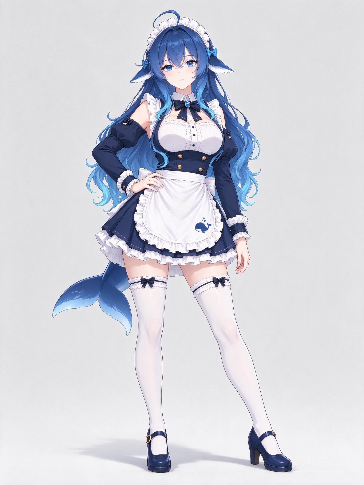
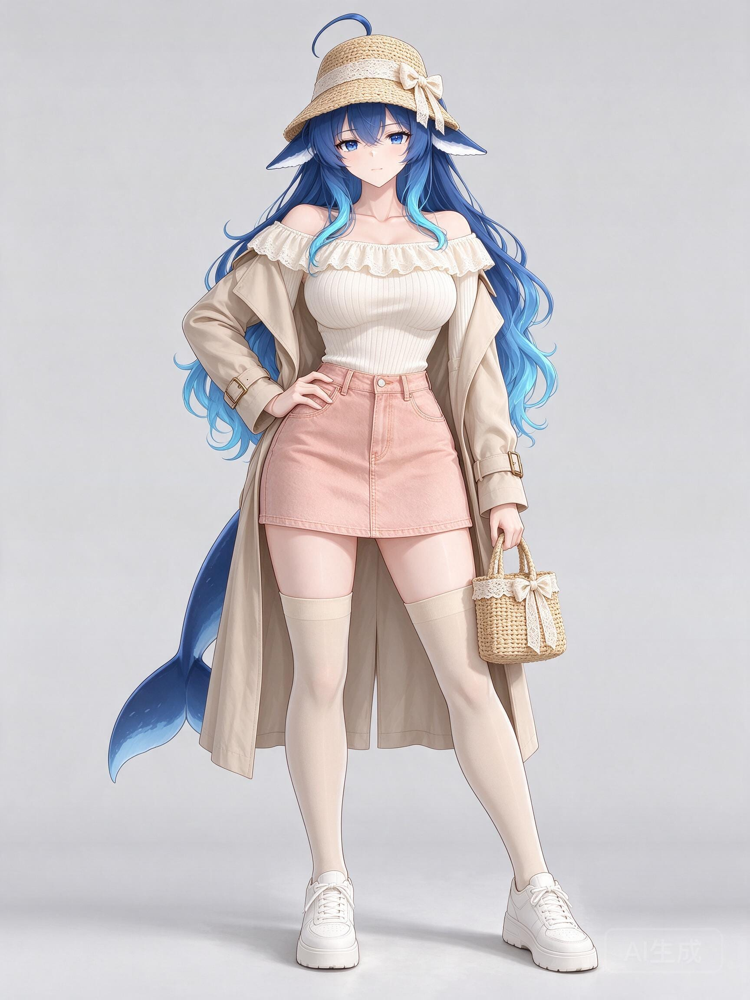
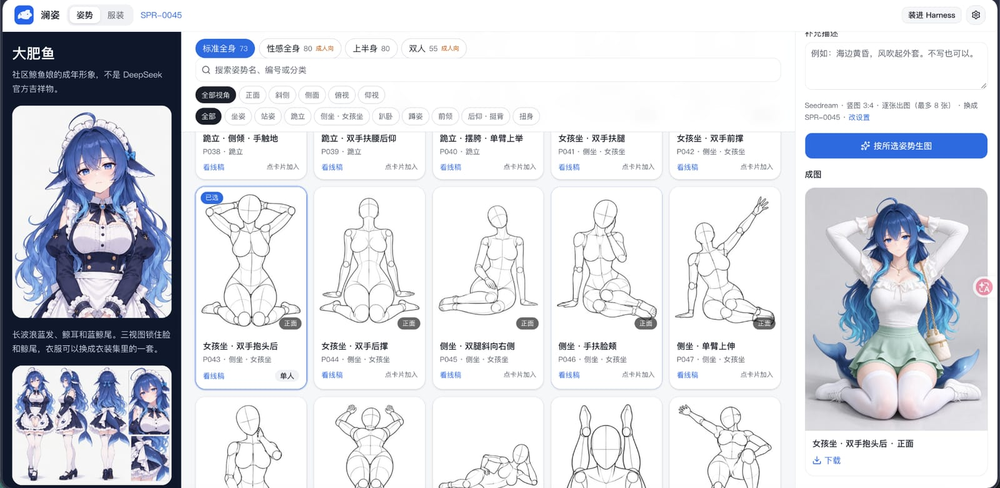
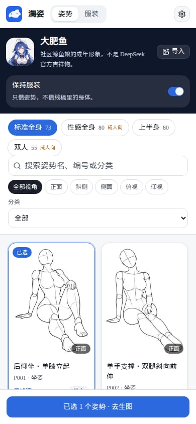
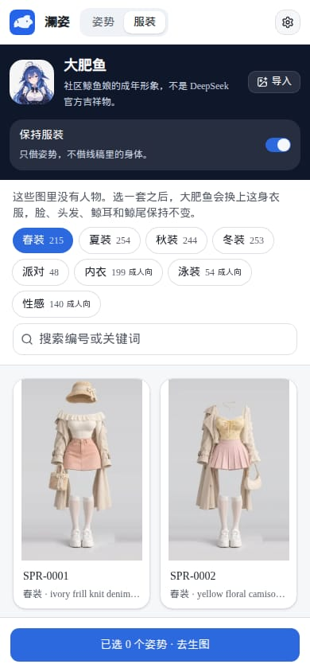
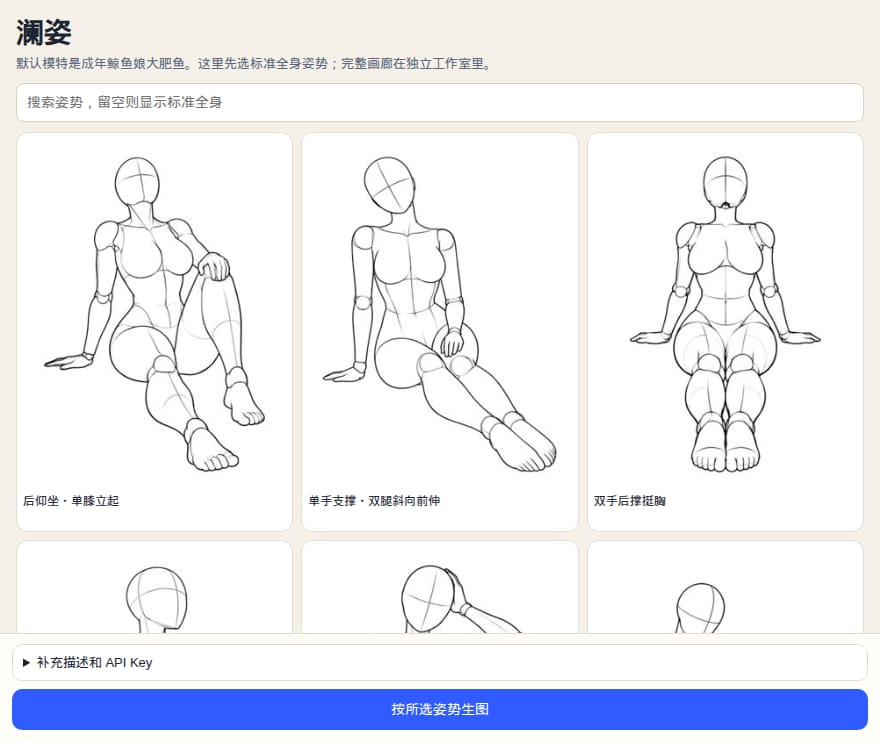

[English](./README.en.md)

# 澜姿

可选的 **ComfyUI 浏览器直连**：在在线网站填写本机或远程 HTTPS 地址，用一套带开关的工作流完成换装、姿势、组合生成及逐格拼图，无需在显卡电脑启动网站。原云端功能保留，详见[连接与工作流说明](docs/comfyui-local.md)。

DeepSeek Harness 插件，也是一个可以单独打开的姿势工作室。从 [ai-pose-gallery-zh](https://github.com/anhao/ai-pose-gallery-zh) 的 288 组、1439 张姿势线稿里选一个或多个姿势，生成同一位模特的图。

默认模特是 **大肥鱼**：社区鲸鱼娘的成年形象，长波浪蓝发、鲸耳、蓝鲸尾，穿海军蓝与白色女仆装。参考图用的是 [TreapGoGo](https://github.com/TreapGoGo) 的 [deepseek-whale-girl](https://github.com/TreapGoGo/deepseek-whale-girl) 里的 `dafeiyu-mature-character-sheet.png`。可以导入最多三张别的模特照片，用来替换脸和衣服。姿势图只提供身体姿态，默认不会把线稿里的空白身体画进成图。

姿势线稿不在这个仓库里。页面会按需读取公开图床 [ai-pose-gallery.anhao.app](https://ai-pose-gallery.anhao.app)。图片与原始数据的著作权归 [ギア](https://x.com/giaaibusi) 所有，中文译名来自 [Anhao](https://github.com/anhao) 的图库。

服装来自 [ギア](https://x.com/giaaibusi) 的 [衣装集 COSTUME-DB-01](https://ai-costume-gallery.pages.dev/)，共 1407 套，图里没有人物。页面按需读取该站点的缩略图，本仓库只保存编号和关键词。选中一套之后，生图会换成这身衣服，并保留角色的脸、发型、鲸耳和鲸尾。内衣、泳装和性感分类跟成人向姿势共用同一个开关。

## 效果

同一套站立姿势「站立・对立式平衡・手扶腰」。第一张保持女仆装，第二张换成衣装集 SPR-0001。

<p>


</p>

选了「女孩坐・双手抱头后」，并换成 SPR-0045 之后，成图出现在右侧。



窄屏时模特收在顶上，分类用下拉，出图按钮留在底部。



服装分类会换行，卡片说明留在屏幕里。



装进 Harness 之后，左侧栏是「澜姿 / 工作室」。点开后用的是同一套工作室：模特、姿势、服装、生图设置和出图都在这一页里。面板够宽时仍是三栏；窄面板收成一列，出图按钮留在底部。



## 本地工作室

需要 Node.js 22.19 或更新版本。

```bash
npm install
npm run dev
```

打开 [http://127.0.0.1:43123](http://127.0.0.1:43123)。

1. 在中间点选姿势，可以多选。标准全身是默认页；性感系和双人姿势需要明确打开「成人向」。
2. 切到「服装」可以单选一套衣服。春夏秋冬和派对默认可见；内衣、泳装、性感需要打开「成人向」。
3. 左侧可以导入其他模特，或继续用大肥鱼。选了服装之后，「保持服装」会暂时让位给这套衣服。
4. 右上角「生图设置」里填写 Gemini 或 OpenAI 兼容接口的密钥。密钥只留在这台浏览器里。
5. 没有密钥时，右侧仍会写出每一张图的提示词，可以复制到已安装的 `dsh-image-gen` 里生图。选了服装时，参考图顺序是角色、没有人物的衣服、姿势线稿。
6. 姿势和服装页都有「自定义」。可以上传参考图，也可以写一句描述，让当前接口把描述扩写成提示词再生成参考图。姿势参考偏向线稿，服装参考是没有人物的平铺。没有密钥或文本接口不可用时，会在本地扩写，提示词仍可复制。自定义内容只存在这台浏览器里。
7. 出图成功后会出现在右侧「历史」。刷新后还在。点开可以看当时的参数，「再用」会恢复姿势、服装和补充描述，然后再出图。可以删除一条，或清空全部。存储快满时会提示清理。

Seedream 走火山方舟 `https://ark.cn-beijing.volces.com/api/v3`，默认模型 `doubao-seedream-5-0-flash-260915`，会把模特图、可选的服装图和姿势线稿一起提交。Gemini 默认模型是 `gemini-2.5-flash-image`。OpenAI 兼容接口会先走 `images/edits`；接口不支持编辑时，会退回纯文生图，并在结果上说明参考图没有送出。

服务器若已配置密钥，可以不把密钥放进浏览器：

```bash
POSE_MUSE_PROVIDER=seedream \
POSE_MUSE_MODEL=doubao-seedream-5-0-flash-260915 \
POSE_MUSE_BASE_URL=https://ark.cn-beijing.volces.com/api/v3 \
POSE_MUSE_API_KEY=你的密钥 \
npm run dev
```

## 装进 DeepSeek Harness

在已经装好 DeepSeek Harness 的机器上执行：

```bash
dsh plugin --profile web add gen-ai-pose-image
```

包名是 `gen-ai-pose-image`。还没发布、或要改本地代码时，把包名换成这个仓库的路径也行。

重启对应 profile 后：

- 左侧栏多一项「澜姿 / 工作室」，和「插件」「自动化任务」排在一起。点开后是完整工作室，可以选姿势、换服装、换模特并生图。
- Agent 可以使用 `search_poses`、`search_costumes` 和 `generate_pose_images`。换装时把服装编号传给 `costume_id`。工作室打开后，自定义姿势和服装也会出现在搜索里，并标成 `source: custom`。`generate_pose_images` 可以传这些 id。如果这台机器上还没有对应的参考图，工具会说明需要先在工作室上传或生成，不会换成图库里的别的姿势或服装。
- 给进程设置 `POSE_MUSE_API_KEY` 后，工具会直接出图并挂到会话里。没有密钥时，工具返回写好的提示词，方便交给 `dsh-image-gen` 的 `generate_image` / `edit_image`。

成人向姿势和成人向服装默认不进搜索结果。只有明确要求时才给 `search_poses` 或 `search_costumes` 传 `include_adult: true`。

## 检查

```bash
npm test
npm run typecheck
```

## 许可

澜姿自己的程序使用 [MIT License](./LICENSE)。数据来源和各自的版权写在 [`shared/license.mjs`](./shared/license.mjs)，并附在 [`LICENSE`](./LICENSE) 末尾。

这份 MIT 许可只覆盖程序。下面的作者和作品另外标注，图片按需读取、不放进仓库：

- 姿势线稿和原始数据的著作权归 [ギア](https://x.com/giaaibusi)。作品是 [AI Pose Gallery](https://ai-pose-gallery.pages.dev/)；中文译名由 [Anhao](https://github.com/anhao) 维护在 [ai-pose-gallery-zh](https://github.com/anhao/ai-pose-gallery-zh)，图床是 [ai-pose-gallery.anhao.app](https://ai-pose-gallery.anhao.app)。上游说明这些图不得用于商业用途。
- 服装图同样来自 [ギア](https://x.com/giaaibusi) 的 [衣装集 COSTUME-DB-01](https://ai-costume-gallery.pages.dev/)。仓库里只有编号和关键词。
- [大肥鱼](https://github.com/TreapGoGo/deepseek-whale-girl) 设定图的作者是 [TreapGoGo](https://github.com/TreapGoGo)，版权所有 (c) 2026 TreapGoGo，按该仓库的 MIT 许可使用。这是社区形象，不代表深度求索。
- [DeepSeek](https://www.deepseek.com/) 是深度求索的商标。这份许可不授予该商标。
